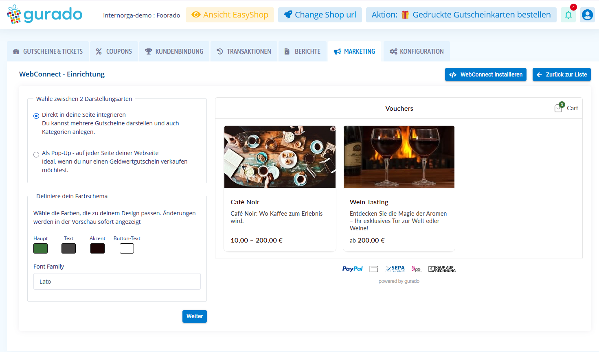
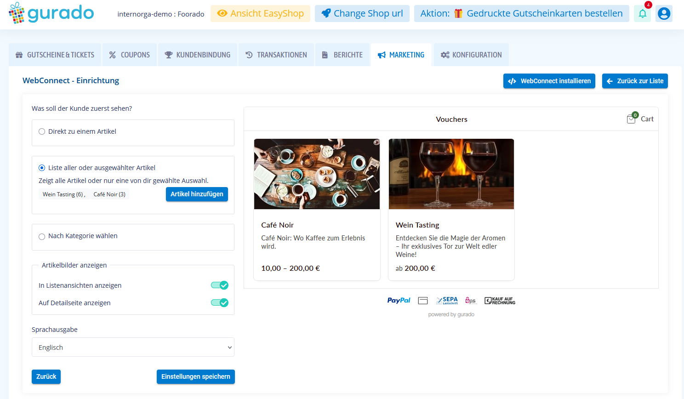
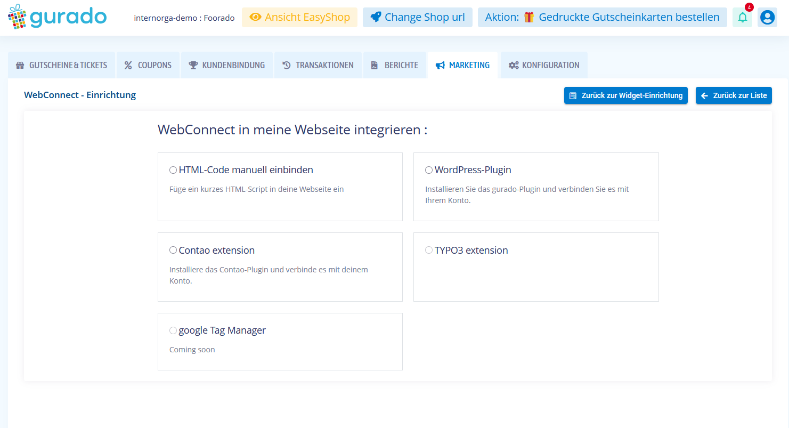
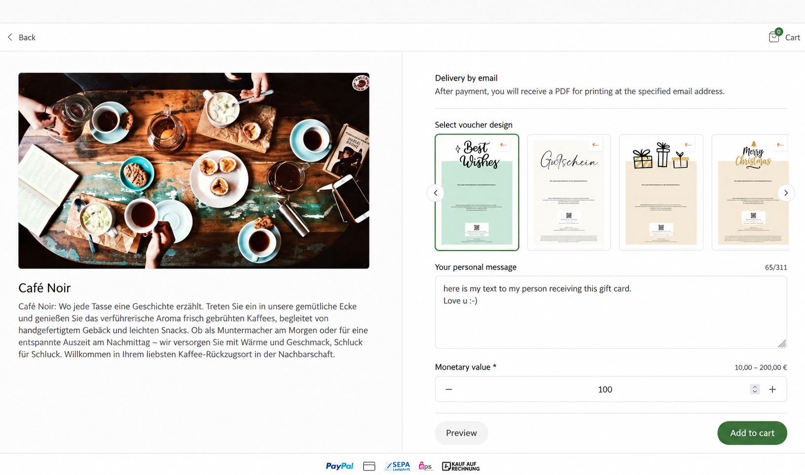
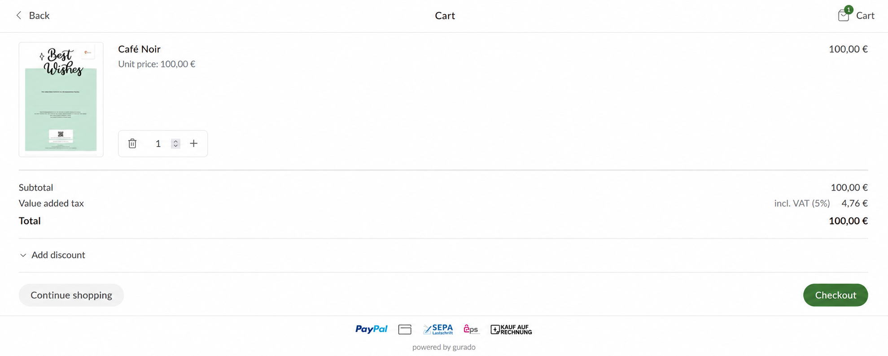
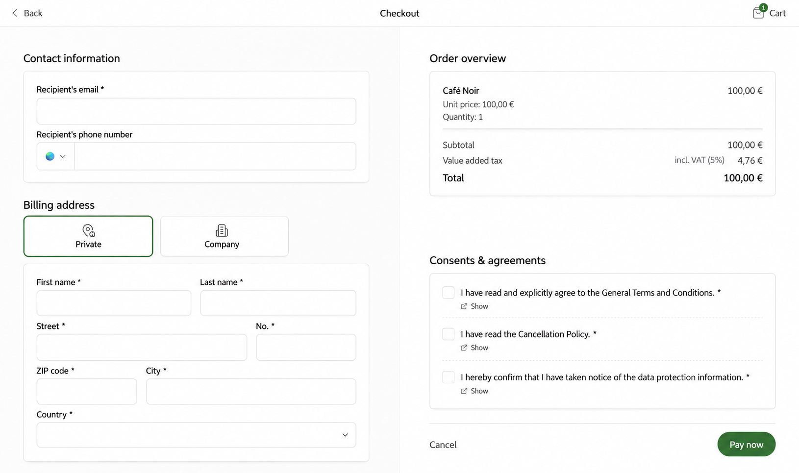

..  _configuration:

=============
Configuration
=============

Configure WebConnect in the gurado Dashboard
============================================

Before integrating WebConnect into TYPO3, create and configure the widget in
your gurado Dashboard under **Marketing > WebConnect**. The setup wizard has
three steps, completed in this order:

Step 1: Display mode and styling
--------------------------------

Choose whether the shop should appear embedded in a page or as a floating
Bubble. Configure the shop's color scheme, including primary color, text,
accent and button text, and select a font family. The preview reflects your
choices.

    Step 1: Select the display mode and customize colors and typography.

Step 2: Articles and display options
------------------------------------

Choose the initial content: a specific article, a list of all or selected
articles, or categories. Depending on the selected presentation, configure
article selection, whether article images appear in listing and detail views,
and the shop language. Save the configuration to continue.

    Step 2: Select articles or categories and adjust additional display settings.

Step 3: Select the integration method
-------------------------------------

**The integration method is the final step**, after the widget has been
configured. Choose **TYPO3 extension** for this integration. The same screen
also offers other integration methods for different website platforms.

    Step 3: Choose TYPO3 extension to integrate the configured shop.

The TYPO3 extension embeds the configured WebConnect shop; styling and article
configuration are managed in the gurado Dashboard. Continue below to
configure the Storecode and mode in TYPO3.

Terminology
===========

**Storecode** is the shop identifier supplied by gurado.
**Article** is the customer-facing name for a voucher product;
the underlying WebConnect HTML API uses the values `product` and `products`.

Bubble Mode: global Site Settings
=================================

Bubble Mode is configured **only in site settings**, not as a content element.

#. Open **Sites > Setup > Edit site settings**.
#. Under **gurado WebConnect**, enter your **Storecode**.
#. Enable **Bubble Mode**.
#. Select the start view and optional position/offsets.
#. Save, clear caches and test the website.

Bubble start views:

* **Default** (recommended): the welcome/splash screen.
* **Articles**: opens the article listing directly.
* **Article**: opens a specific article directly; supply its numeric Article ID.

The original welcome screen is the most suitable default for sites
using only Bubble Mode, especially with larger article catalogs.

The setting is per TYPO3 site. The floating widget is normally displayed
across its frontend pages when enabled.

Embed Mode: content element
===========================

#. Open the desired page in the TYPO3 backend.
#. Add the **gurado WebConnect** content element.
#. Enter the **Storecode**.
#. Select one of the supported views and save.

* **Articles** (default): lists voucher articles.
* **Categories**: displays voucher categories.
* **Single article**: immediately opens one article by numeric Article ID.

The Default splash screen, Cart and Checkout starting views are intentionally
not offered in Embed Mode.

To avoid duplication, Bubble Mode is not offered in the content-element editor.

Screenshots: Bubble Mode
========================

The following examples show the floating widget on a website. The highlighted
area indicates the Bubble Mode trigger or panel.

    Bubble Mode: closed trigger on the website.

    Bubble Mode: default welcome screen.

    Bubble Mode: a specific voucher article inside the floating panel.

Screenshots: Embed Mode
=======================

Embed Mode renders the shop as part of the page rather than a floating panel.
The following screenshots illustrate the customer journey. Cart and checkout
are accessible during shopping, but are **not selectable start views** in the
TYPO3 content element.

    Embed Mode: voucher article configuration.

    Embed Mode: shopping cart during checkout flow.

    Embed Mode: checkout form.

Technical embedding
===================

The extension outputs the `<gurado-widget>` Web Component and loads the script
from `https://statics.gurado.de/widget/assets/widget.js`.
The underlying HTML attributes are named `shop`, `mode`, `page`,
`product`, `align`, `offsetX` and `offsetY`.

A website's Content Security Policy or consent-management configuration
may require additional integration-specific settings.
